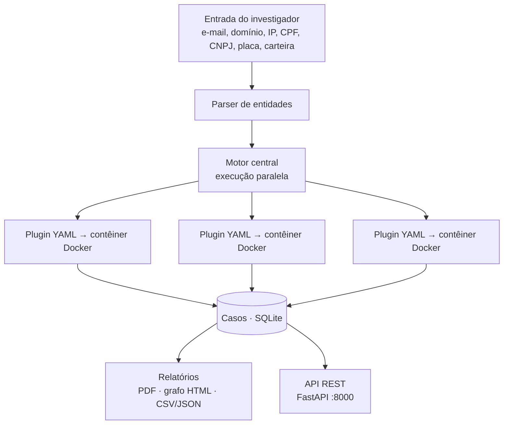

# Colombo-SCAN

> Framework de OSINT e perícia digital que identifica o tipo de alvo, roda plugins em contêineres Docker isolados e gera dossiês com grafo de relacionamentos.

   

> [!CAUTION]
> Uso exclusivo para fins defensivos, perícia legalmente autorizada, ensino e auditorias autorizadas
> (bug bounty com permissão expressa). Respeite a LGPD e os termos de uso de cada API consultada.
> Os autores não se responsabilizam por uso indevido.

## Sumário

- [Sobre](#sobre) · [Funcionalidades](#funcionalidades) · [Arquitetura](#arquitetura) · [Requisitos](#requisitos)
- [Instalação](#instalação) · [Uso](#uso) · [Configuração](#configuração) · [Plugins](#plugins)
- [Testes](#testes) · [Estrutura do projeto](#estrutura-do-projeto) · [Licença](#licença)

## Sobre

O Colombo-SCAN automatiza a investigação em fontes abertas. O investigador informa um ou mais
alvos (e-mail, domínio, IP, telefone, CPF, CNPJ, placa, carteira cripto…); o sistema reconhece e
normaliza cada um, escolhe os plugins compatíveis, roda cada ferramenta num contêiner Docker
descartável (sem sujar a máquina) e consolida os achados em casos, grafos e relatórios.

## Funcionalidades

- Reconhece e normaliza alvos: e-mail, usuário, telefone (E.164), domínio, IP/CIDR, CPF e CNPJ (com dígito verificador), placa Mercosul e antiga, carteiras BTC/ETH/LTC.
- Roda 167 plugins em 26 categorias, em paralelo, cada um num contêiner isolado.
- Adiciona ferramentas novas só com um arquivo YAML, sem mexer no código.
- Aprofunda a busca: um e-mail ou usuário novo encontrado vira um novo alvo, com rastreio de origem.
- Guarda casos, entidades e correlações em SQLite.
- Gera grafo interativo em HTML, relatório em PDF e exportação CSV/JSON.
- Oferece menu interativo no terminal e API REST.

## Arquitetura



## Requisitos

- Linux (Ubuntu 22.04+, Debian 12, Kali) ou WSL2.
- Docker Engine com o serviço rodando.
- Python 3.10 ou superior.

## Instalação

1. Clone o repositório:

   ```bash
   git clone https://github.com/VituColombo0/Colombo-SCAN.git
   ```

2. Dê permissão ao script de inicialização:

   ```bash
   cd Colombo-SCAN && chmod +x run_colombo.sh
   ```

3. Crie o arquivo de variáveis a partir do modelo e preencha as chaves que tiver:

   ```bash
   cp .env.example .env
   ```

Na primeira execução, o `run_colombo.sh` cria o ambiente virtual e instala as dependências.

## Uso

**Menu interativo:**

```bash
./run_colombo.sh
```

**Varredura direta de um alvo** (gera o relatório no fim):

```bash
./run_colombo.sh --alvo 198.51.100.24
```

**API REST** (Swagger em `http://localhost:8000/docs`):

```bash
./run_colombo.sh --api
```

| Método | Rota | Função |
| :--- | :--- | :--- |
| GET | `/plugins` · `/categories` | Lista plugins e categorias |
| POST | `/scan` | Inicia uma varredura |
| GET | `/scan/{scan_id}/results` | Resultado da varredura |
| POST / GET | `/cases` | Cria e lista casos |
| GET | `/cases/{case_id}` | Detalhe do caso |
| GET | `/cases/{case_id}/entities` | Entidades do caso |
| GET | `/cases/{case_id}/correlations` | Correlações do caso |

## Configuração

| Arquivo | Para quê |
| :--- | :--- |
| `.env` (modelo: [.env.example](.env.example)) | Chaves de APIs: Shodan, Censys, Hunter, HIBP, DeHashed, VirusTotal, OpenCorporates… |
| `.scan_auth.yaml` | Cookies e tokens de sessão (GitHub, Instagram, Twitter, Shodan) injetados como variáveis de ambiente nos plugins |

> [!IMPORTANT]
> Nunca faça commit de chaves reais. O `.scan_auth.yaml` versionado traz só valores de exemplo;
> preencha a sua cópia local e não a envie ao repositório.

## Plugins

Cada plugin é um YAML em `plugins/<categoria>/`. Exemplo real
(`plugins/geolocalização/ip-api_lookup.yaml`):

```yaml
name: IP-API Lookup
category: 🌍 Geolocalização
description: IP-API Lookup plugin
type: docker
image: curlimages/curl
command: -s http://ip-api.com/json/{alvo}
inputs:
- id: alvo
  prompt: 'IP:'
```

**Categorias:** redes e IPs (25), geolocalização (12), vazamentos (12), identidades e usernames (10),
e-mails (9), telefones (9), redes sociais (9), DevSecOps e vulnerabilidades (10), imagens (8),
criptomoedas (8), documentos (6), superfície de ataque (11), IoT/Shodan (10), busca (5),
empresas e CNPJ (4), áudio e vídeo forense (4), veículos e placas (3), dark web (3),
busca reversa de imagem (3), voos (2) e outras. Como criar um plugin: [CONTRIBUTING.md](CONTRIBUTING.md).

## Testes

Com o `pytest` instalado (`pip install pytest`):

```bash
python -m pytest tests
```

Os scripts `tests/bug_hunt_*.py` são verificações manuais da API e dos relatórios.

## Estrutura do projeto

```text
Colombo-SCAN/
├── main.py           # ponto de entrada (menu, --alvo, --api)
├── run_colombo.sh    # prepara o ambiente e chama o main.py
├── core/             # motor, parser de entidades, casos, grafo, relatórios
├── api/server.py     # API REST (FastAPI)
├── ui/               # menus do terminal (Rich/Questionary)
├── plugins/          # 167 plugins YAML em 26 categorias
├── scripts/          # verificação de imagens e geradores de plugins
├── tests/            # testes
└── CONTRIBUTING.md   # como contribuir e criar plugins
```

## Equipe

Desenvolvido por Victor Colombo.

## Licença

Distribuído sob a licença MIT. Veja [LICENSE](LICENSE).
